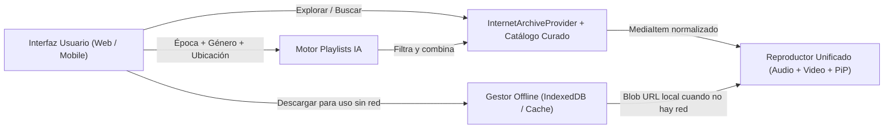

# Arquitectura Técnica y Estrategia Web → Móvil — Archive Player

## 1. Principios Arquitectónicos
Para cumplir el objetivo de **iniciar con un prototipo Web ágil (Fase 1)** y **escalar a una aplicación móvil Android/iOS (Fase 2)** sin reescribir la lógica del proyecto:

1. **Arquitectura Limpia por Capas (Core Desacoplado):**
   * La lógica de datos, normalización de APIs (`archive.org`), generador de playlists IA y estado global viven en `src/services/` y `src/store/`, completamente independientes de si la vista es Web o Móvil.
2. **PWA + Media Session API desde el Día 1:**
   * Uso del estándar `navigator.mediaSession` para que, incluso desde el navegador móvil en Android/iOS, el usuario vea la carátula, título y controles de Play/Pause/Siguiente en la pantalla de bloqueo y notificaciones.
3. **Ruta directa a Android / iOS:**
   * El proyecto se estructura con **React + TypeScript + Vite + Tailwind CSS**, listo para envolverse con **Capacitor (`@capacitor/core`)** en un solo comando para generar los proyectos nativos de **Android Studio (`android/`)** y **Xcode (`ios/`)**, o compartir `src/services/` y `src/types/` con React Native.

---

## 2. Estructura de Carpetas del Proyecto

```text
archive_player/
├── AGENTS.md                        # Reglas y contexto automático para agentes de IA
├── README.md                        # Guía general e instrucciones de ejecución
├── brief.md                         # Brief conceptual inicial
├── docs/                            # Documentación viva del proyecto
│   ├── 01-SPECIFICATION.md          # Especificación funcional detallada
│   ├── 02-ARCHITECTURE.md           # Arquitectura técnica y modelo de datos
│   ├── 03-DATA-SOURCES.md           # Guía de APIs abiertas (archive.org, licencias)
│   └── 04-ROADMAP.md                # Plan de desarrollo por fases y estado actual
├── .agents/                         # Personalizaciones y Skills para agentes
│   └── skills/
│       └── archive-api/
│           └── SKILL.md             # Manual técnico para consultar Internet Archive API
├── public/                          # Activos estáticos e íconos PWA
└── src/                             # Código fuente de la aplicación
    ├── types/                       # Contratos e interfaces TypeScript
    │   └── media.ts                 # MediaItem, Artist, Album, Playlist, LicenseInfo
    ├── data/                        # Catálogo curado de respaldo (Audio + Video verificados)
    │   └── curatedCatalog.ts        # Obras icónicas de archive.org listas para streaming
    ├── services/                    # Lógica de negocio (reutilizable en Web y Móvil)
    │   ├── providers/               # Conectores a repositorios abiertos
    │   │   └── internetArchive.ts   # Cliente de búsqueda y streaming de archive.org
    │   ├── ai/                      # Motor de sugerencias y playlists IA
    │   │   └── playlistGenerator.ts # Generador por época, género, ubicación y clima
    │   └── offline/                 # Gestión de descargas para uso sin internet
    │       └── offlineStorage.ts    # Almacenamiento de blobs en IndexedDB / Cache API
    ├── store/                       # Estado global reactivo (Reproductor, Favoritos, Playlists)
    │   └── PlayerContext.tsx
    ├── hooks/                       # Custom hooks de React (audio/video sync, red offline)
    ├── components/                  # Componentes de UI modulares
    │   ├── layout/                  # Sidebar (Desktop), BottomNav (Móvil), Header
    │   ├── player/                  # Barra de reproducción, Visor Video/PiP, Liner Notes
    │   ├── catalog/                 # Tarjetas de Artista, Álbum/Obra, Pistas
    │   ├── ai-dj/                   # Interfaz del Generador de Playlists IA
    │   └── library/                 # Mis Playlists, Favoritos y Gestor de Descargas Offline
    ├── App.tsx                      # Enrutador de vistas principal
    └── main.tsx                     # Punto de entrada de la aplicación
```

---

## 3. Modelo de Datos Unificado (`src/types/media.ts`)

Todos los proveedores externos (`archive.org`, Musopen, FMA, etc.) se transforman a este esquema normalizado:

```typescript
export type MediaType = 'audio' | 'video';

export type ArchiveSource =
  | 'internet_archive'
  | 'fma'
  | 'musopen'
  | 'imslp'
  | 'public_domain_review'
  | 'open_music_archive'
  | 'nfb';

export interface LicenseInfo {
  code: 'PUBLIC_DOMAIN' | 'CC0' | 'CC-BY' | 'CC-BY-SA' | 'CC-BY-NC';
  label: string;           // Ej. "Dominio Público (CC0)"
  url?: string;            // URL oficial de la licencia
  attributionText: string; // Texto listo para copiar por creadores
}

export interface MediaItem {
  id: string;                  // Identificador único (ej. identifier de archive.org)
  title: string;               // Título limpio de la pista u obra
  artist: string;              // Artista, compositor o director
  albumOrCollection: string;   // Álbum, obra o colección de archivo
  mediaType: MediaType;        // 'audio' | 'video'
  streamUrl: string;           // URL directa a MP3 / OGG / MP4
  downloadUrl: string;         // URL directa para descarga offline
  thumbnailUrl: string;        // Portada o fotograma
  durationSeconds?: number;    // Duración en segundos
  year?: number;               // Año de grabación o estreno
  decade: string;              // Ej. "1920s", "1950s", "Siglo XIX", "2010s"
  genres: string[];            // Ej. ["Jazz", "Swing", "Vintage 78rpm"]
  moods: string[];             // Ej. ["Nostálgico", "Lluvioso", "Nocturno", "Enfoque"]
  region?: string;             // Origen geográfico/cultural (ej. "Nueva Orleans, EE.UU.", "Europa")
  source: ArchiveSource;       // Repositorio de origen
  sourcePageUrl: string;       // Enlace a la ficha original en archive.org
  license: LicenseInfo;        // Información de licencia abierta
  historicalContext: string;   // Notas históricas ("Liner Notes") para mostrar en el reproductor
}

export interface Playlist {
  id: string;
  name: string;
  description: string;
  coverUrl?: string;
  createdAt: string;
  isAiGenerated: boolean;
  aiContext?: {
    era?: string;
    genre?: string;
    locationOrWeather?: string;
    mood?: string;
  };
  items: MediaItem[];
}
```

---

## 4. Flujo de Reproducción y Descarga Offline



* **Detección de Red (`navigator.onLine`):** Cuando el usuario descarga una pista o video, el archivo binario (`Blob`) se almacena en `IndexedDB` bajo la clave `item.id`. Si el reproductor detecta que el ítem ya está descargado localmente, reproduce desde el `Blob URL` local instantáneamente sin consumir datos ni requerir conexión a internet.

