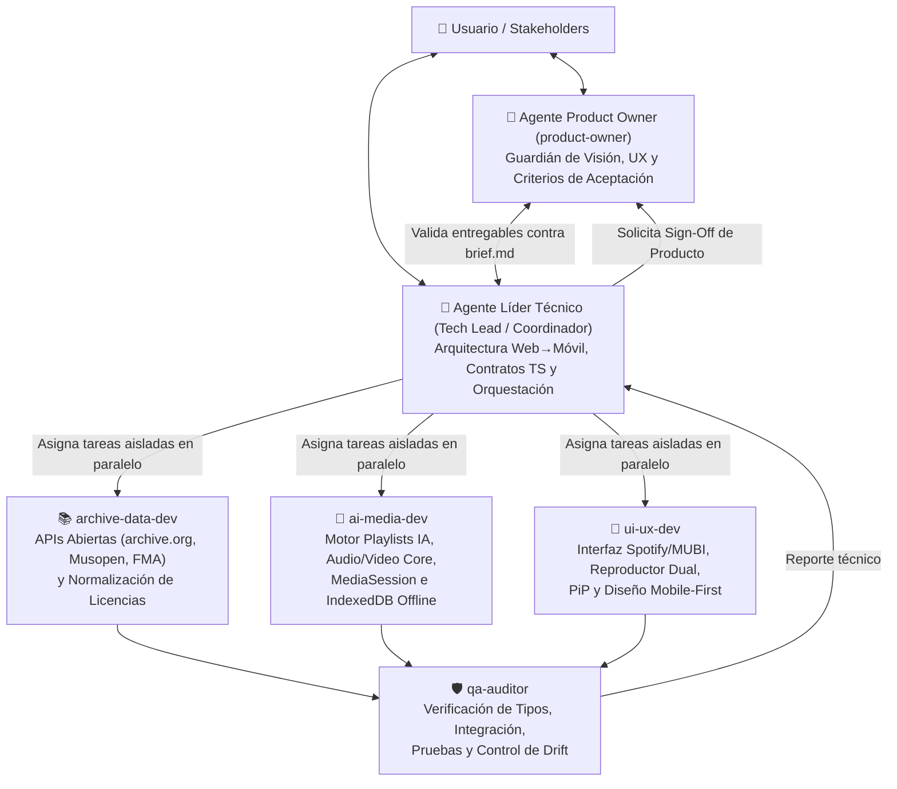

# Estructura de Equipo Multi-Agente y Workflow Anti-Drift — Archive Player

Este documento define la organización del equipo de agentes de IA, la asignación de responsabilidades por dominio y el flujo de trabajo obligatorio (**5-Gate Anti-Drift Loop**) para garantizar calidad, velocidad en paralelo y alineación total con la visión del producto.

---

## 1. Organigrama del Equipo Multi-Agente (Squad)

---

## 2. Definición de Roles y Matriz de Propiedad de Archivos (File Ownership Lock)

Para evitar colisiones cuando los agentes trabajan en paralelo, cada especialista es dueño exclusivo de su capa del repositorio:

| Agente (`TypeName`) | Rol y Especialidad | Archivos Bajo su Propiedad Exclusiva | Restricciones |
| :--- | :--- | :--- | :--- |
| **Tech Lead** *(Agente Principal)* | Arquitecto Web→Mobile y Orquestador Técnico | `src/types/**`, `package.json`, `vite.config.ts`, `tsconfig.json`, `docs/02-ARCHITECTURE.md`, `docs/06-ADR-LOG.md` | Único autorizado para modificar contratos en `src/types/media.ts`. |
| **`product-owner`** | Product Owner & Auditor UX | `docs/01-SPECIFICATION.md`, `docs/04-ROADMAP.md` (evaluación) | **Solo lectura en código (`EnableWriteTools: false`)**. Evalúa de forma imparcial sin sesgo de implementación. |
| **`archive-data-dev`** | Especialista en Repositorios Culturales y APIs | `src/data/**`, `src/services/providers/**` | No modifica componentes UI ni el estado global. |
| **`ai-media-dev`** | Especialista en IA Musical, Reproducción y Offline | `src/services/ai/**`, `src/services/offline/**`, `src/store/**`, `src/hooks/**` | Debe mantener su código agnóstico para reutilizarse en Android/iOS. |
| **`ui-ux-dev`** | Especialista en Frontend React, Tailwind y UX Táctil | `src/components/**`, `src/App.tsx`, `src/index.css` | Consume únicamente los contratos de `src/types/media.ts` y `usePlayer()`. |
| **`qa-auditor`** | Especialista en Integración, Compilación y Anti-Drift | Auditoría transversal y corrección de errores de integración/tipos | No introduce funcionalidades nuevas no especificadas. |

---

## 3. Workflow Anti-Drift: Protocolo de 5 Puertas ("5-Gate Loop")

El **Drift (deriva del desarrollo)** ocurre cuando los agentes olvidan requerimientos originales, inventan tipos incompatibles entre sí o construyen funciones que no aportan al objetivo de la fase actual. Para evitarlo, todo ciclo de trabajo sigue **5 puertas obligatorias**:

### Puerta 1: Contrato Primero (`Contract-First Freeze`)
1. El **Tech Lead** revisa `docs/01-SPECIFICATION.md` y `docs/04-ROADMAP.md`.
2. Si se requiere un nuevo dato o método, el **Tech Lead** actualiza y congela primero `src/types/media.ts` **antes** de lanzar a los desarrolladores en paralelo.

### Puerta 2: Despacho Paralelo con Fronteras Estrictas (`Scoped Parallel Dispatch`)
1. El **Tech Lead** invoca en paralelo a `archive-data-dev`, `ai-media-dev` y `ui-ux-dev`.
2. Cada prompt de invocación incluye:
   * Los archivos exactos que puede crear/editar.
   * Los contratos exactos de `src/types/media.ts` que debe exportar o consumir.

### Puerta 3: Auditoría Técnica de Integración (`QA & Build Gate`)
1. Al concluir los agentes desarrolladores, el **Tech Lead** o el agente **`qa-auditor`** verifica:
   * Que no existan imports faltantes ni discrepancias de tipos (`tsc --noEmit` / `vite build`).
   * Que las URLs multimedia y el fallback local funcionen correctamente.

### Puerta 4: Evaluación del Product Owner (`PO Acceptance Gate`)
1. Se invoca al agente **`product-owner`** para que inspeccione el resultado frente a `brief.md` y `docs/01-SPECIFICATION.md`.
2. El Product Owner califica:
   * **Fidelidad funcional:** ¿Organiza por artista/álbum? ¿El generador IA usa época, género, artista y ubicación/clima? ¿Funciona audio, video y modo offline?
   * **Fidelidad cultural/legal:** ¿Se muestran las fuentes abiertas y licencias?
   * **Disciplina de Fase:** ¿Evita complejidad innecesaria de Fase 2 mientras mantiene la arquitectura lista para móvil?
3. Si el dictamen del PO es `REQUIERE AJUSTES`, el Tech Lead asigna las correcciones puntuales antes de cerrar el hito.

### Puerta 5: Sincronización de Documentación y Memoria (`Doc & ADR Sync`)
1. Ningún hito se marca como completado sin actualizar `docs/04-ROADMAP.md` y registrar cualquier decisión técnica relevante en `docs/06-ADR-LOG.md`.

---

## 4. Estructura y Flujo de Trabajo en Git (Multi-Agente)

### 4.1. Archivos de Control Git en el Repositorio
* [`.gitignore`](../.gitignore) — Excluye `node_modules/`, `dist/`, artefactos nativos de Android/iOS (`android/app/build/`, `ios/App/Pods/`) y secretos `.env`.
* [`.gitattributes`](../.gitattributes) — Normaliza saltos de línea (`LF` en código fuente, `CRLF` en scripts Windows).
* [`.env.example`](../.env.example) — Plantilla documentada de variables de entorno sin credenciales sensibles.
* [`.github/PULL_REQUEST_TEMPLATE.md`](../.github/PULL_REQUEST_TEMPLATE.md) — Checklist obligatorio de las **5 Puertas Anti-Drift** en cada entrega.
* [`.github/workflows/ci-anti-drift.yml`](../.github/workflows/ci-anti-drift.yml) — Pipeline de Integración Continua que ejecuta `tsc --noEmit` y `npm run build`.

### 4.2. Modelo de Ramas (Branching Strategy)
* `main`: Rama estable verificada por el **QA Auditor** y aprobada por el **Product Owner**.
* `develop`: Rama de integración de sprints multi-agente.
* Ramas por agente/funcionalidad (cuando se trabaja en ramas aisladas `Workspace: 'branch'` o `'share'`):
  * `feat/data/<nombre>` — Exclusiva de `archive-data-dev`.
  * `feat/ai-media/<nombre>` — Exclusiva de `ai-media-dev`.
  * `feat/ui/<nombre>` — Exclusiva de `ui-ux-dev`.
  * `fix/qa/<nombre>` — Correcciones de `qa-auditor`.

### 4.3. Convención de Commits (Conventional Commits)
Formato obligatorio en inglés técnico con alcance del módulo:
* `feat(catalog): add verified Musopen and 78rpm streams`
* `feat(ai-dj): implement contextual playlist generator by era and weather`
* `feat(player): add unified audio/video bar with silent film visualizer`
* `docs(adr): record offline IndexedDB storage decision`
